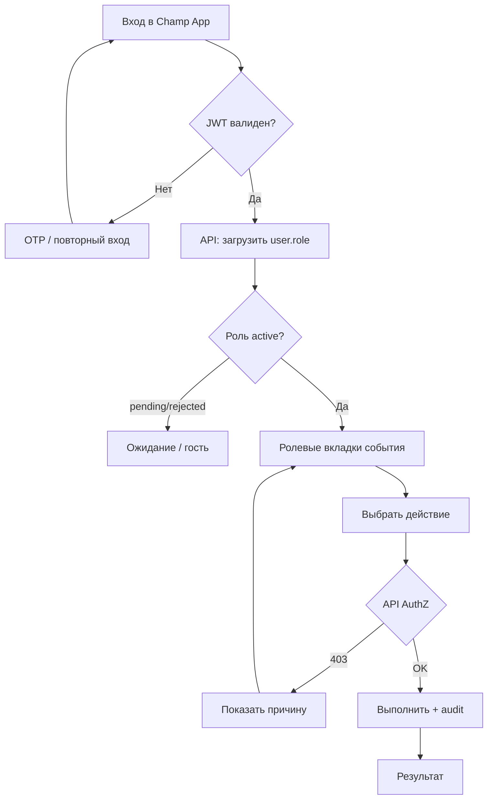
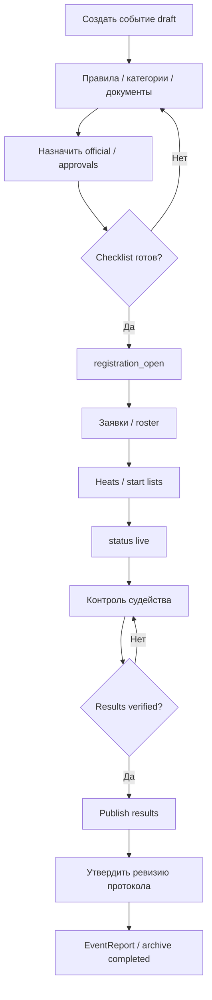
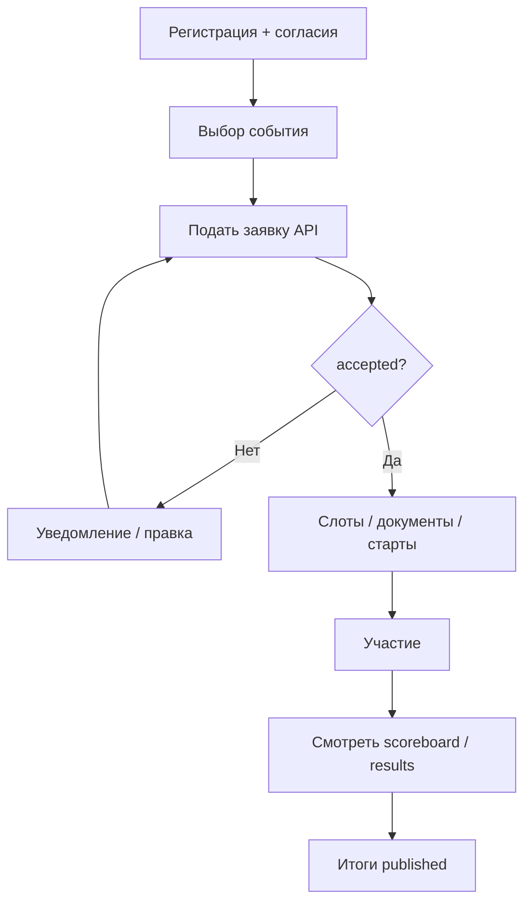
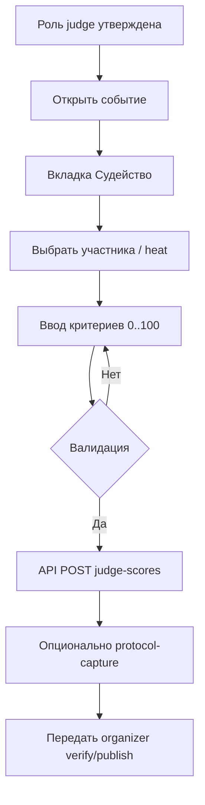
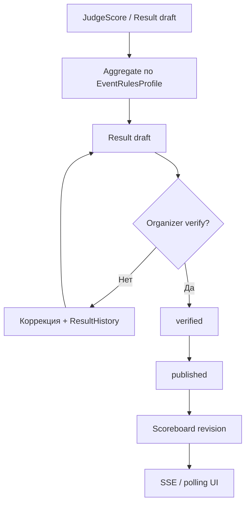
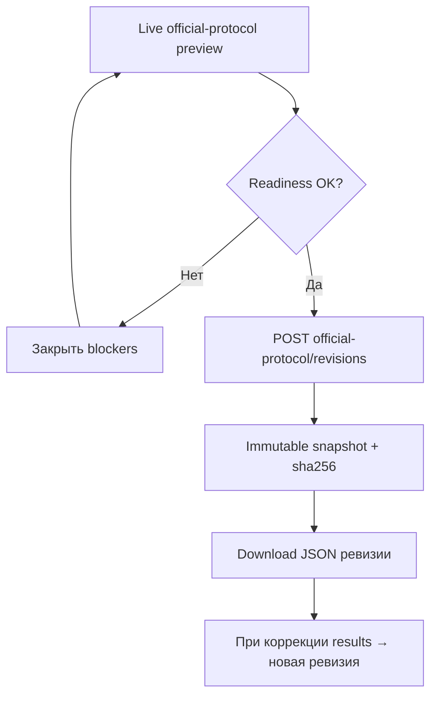
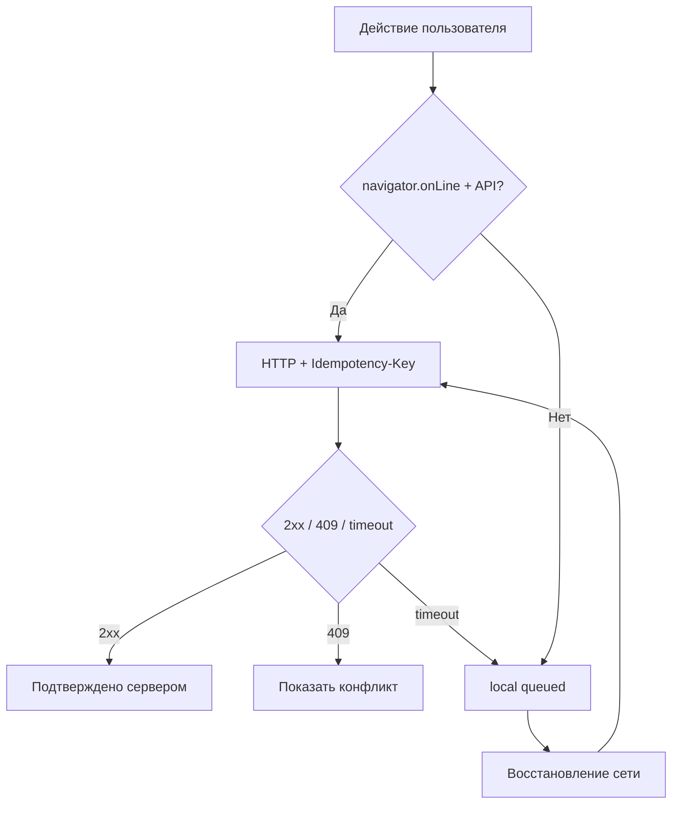
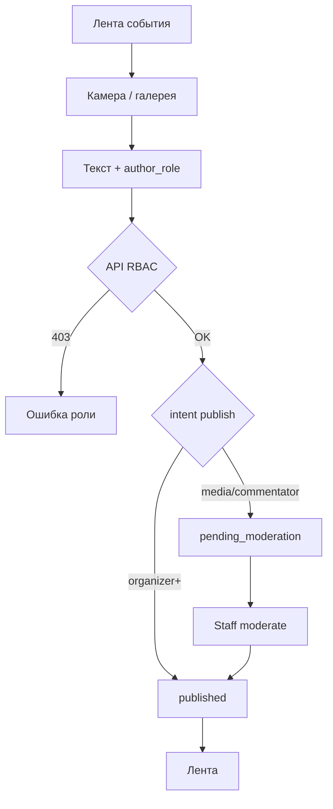
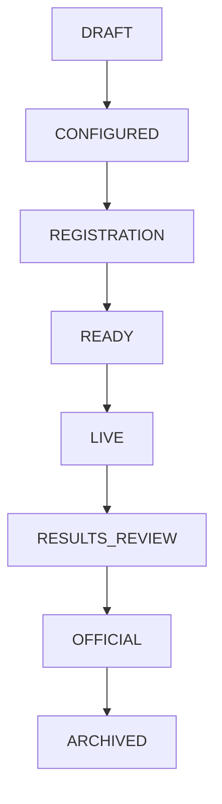

# Workflow Diagrams — Champ App (Agent 12)

Дата: 2026-11-04  
Статус: каталог процессов, согласованный с фактическим кодом + целевыми расширениями 0.5.17  
Роли в коде: см. `services/api/app/domain/roles.py`  
Схемы — Mermaid flowchart; экспорт SVG/PNG — через IDE/CI при наличии mermaid-cli (не обязателен для runtime).

Легенда: прямоугольник = шаг; ромб = решение; «API» = серверная операция; «local» = клиент.

## Схема A — Роли и доступ

## Схема B — Организатор

## Схема C — Участник (participant)

## Схема D — Судья

## Схема E — Online Scoring

## Схема F — Протоколы

## Схема G — Online / Offline

## Схема H — Публикация контента

## Схема I — Жизненный цикл

`journey_phase` вычисляется поверх `EventStatus` (ADR-0015), статусы API не ломаются.

## Role × Action × State (фактические роли кода)

| Роль | Prep | Live | After |
|------|------|------|-------|
| organizer / event_admin / federation_manager / platform_admin | событие, checklist, approvals | verify/publish, scoreboard staff | protocol revision, report, archive |
| judge | назначение | judge-scores, protocol-capture | свои листы |
| participant | заявка, согласия | статус, табло | published results |
| media / commentator | — | лента постов, report edit | черновики отчёта |
| support | — | participants/docs | — |
| guest / public | витрина | scoreboard published | published results |

Нет отдельных ролей «главный судья / секретарь / тренер» в API — capabilities через organizer+/judge/participant.
